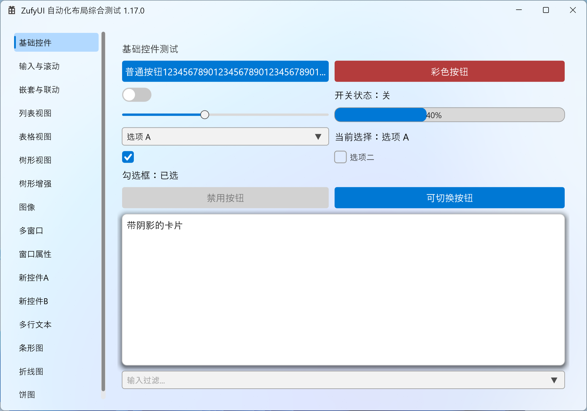
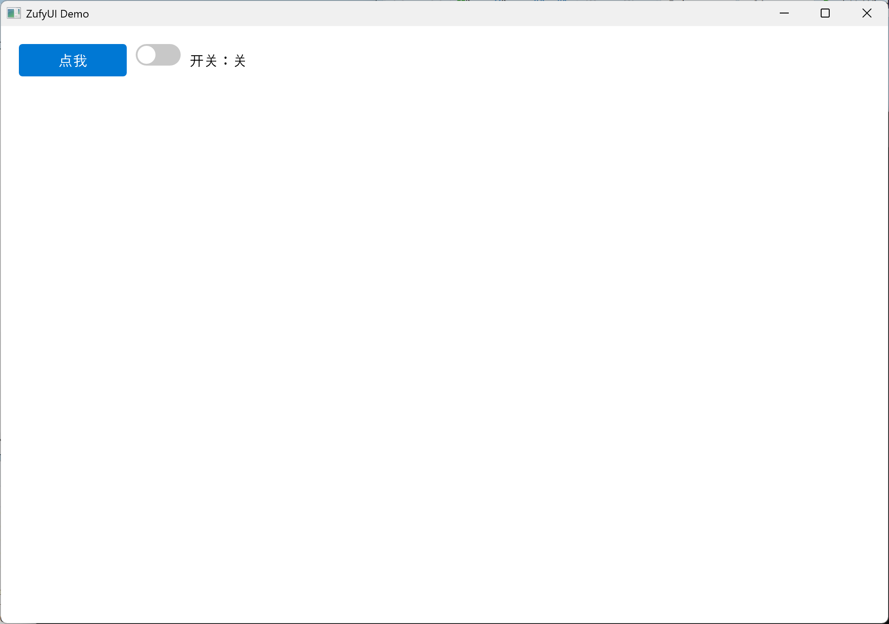
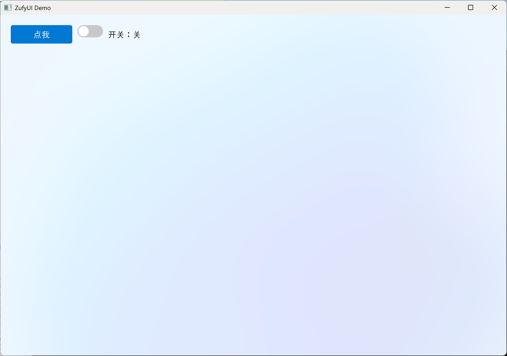
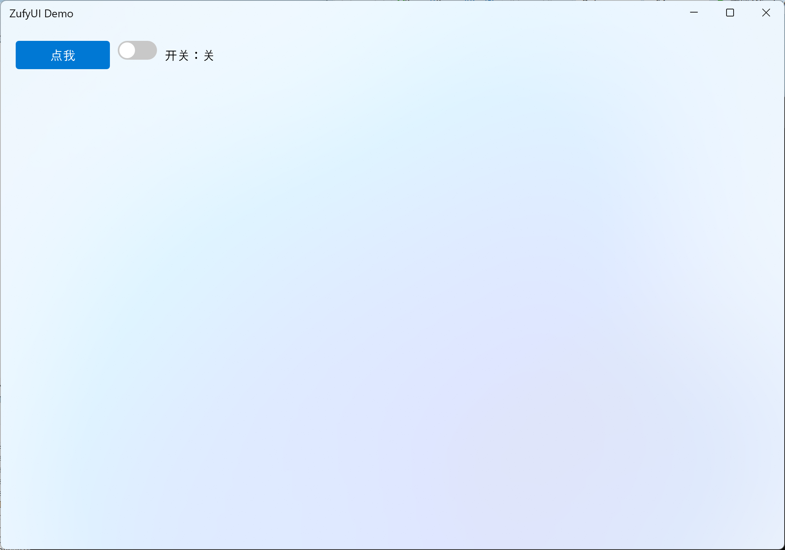

# ZufyUI

**轻量到几 MB，快到原生合成。** 纯头文件、零第三方依赖的 C++20 Windows 自绘 UI 框架，直接构建在 Direct2D 1.1 + DirectComposition 之上。

- **没有 Qt 的打包包袱，没有 Electron 的内存税。** 几个头文件，`#include` 即用；应用工程不链接任何第三方库。
- **WinUI 3 / Fluent Design 风格。** 亚克力 / 云母、圆角、层次阴影、强调色与动效，接近 Windows 11 原生观感。
- **能嵌原生内容。** `HwndView` 把 WebView2、摄像头、第三方控件甚至进程外 HWND 嵌进布局（跨进程、区域裁剪、随窗口移动）。

> 适合：仅限 Windows 的系统工具、工控上位机、需要 WebView2 / 视频窗口的桌面客户端，以及想摆脱 MFC / Qt 体积与授权问题的团队。

**👉 [下载 Release Demo](https://github.com/zhc9968/ZufyUI/releases)** · [Gitee Releases](https://gitee.com/zhc9968/ZufyUI/releases) · [在线 API](https://zhc9968.github.io/ZufyUI/docs/API.html) · [English](README.en.md) · MIT



> 实验特性：独立渲染线程（`ZUFYUI_RENDER_THREAD`）默认关闭，详见文末「实验特性」。默认单线程路径是稳定的。

## 快速开始

> 目标：**10 分钟内跑出第一个窗口**，并清楚接下来该看哪一章。按下面的步骤走即可。

**第 0 步：准备（纯头文件，零构建配置）**
- 把 `ZufyUI.h`、`ZufyUIWidgets.h`、`ZDataViewer.h`、`ZufyUICharts.h`、`ZufyUIWindowTool.h`、`ZufyUIDragDrop.h` 所在目录加入**包含路径**即可；**不需要编译任何 .cpp**，也不依赖第三方库。
- 依赖的系统库全部由库内 `#pragma comment(lib, ...)` 自动链接（完整清单见「环境要求」）。
- GUI 程序入口用 **`wWinMain` + `/SUBSYSTEM:WINDOWS`**。
- 环境对 BOM / 中文源码不友好时，先运行 [纯 ASCII 导出](#纯-ascii-导出)，用 `dist/ascii` 里的头文件。
- **⚠ 入口易错**：若坚持写 `int main()`，必须把子系统设成 `/SUBSYSTEM:CONSOLE`，或加 `#pragma comment(linker, "/SUBSYSTEM:WINDOWS /ENTRY:mainCRTStartup")`，否则链接器找不到入口。

**第 1 步：最小窗口 + 一个按钮 + 一个开关**

```cpp
#include "ZufyUIWidgets.h"
using namespace ZufyUI;

int WINAPI wWinMain(HINSTANCE, HINSTANCE, LPWSTR, int) {
    Window win;
    if (!win.Create(1000, 700, L"ZufyUI Demo"))
        return 1;

    auto root = win.GetRootColumnBox();
    root->SetSpacing(10);

    auto row = std::make_shared<RowBox>();
    row->SetSpacing(10);

    auto btn = std::make_shared<Button>(L"点我");
    btn->Connect(btn->Clicked, []() {
        MessageBoxW(nullptr, L"Hello ZufyUI!", L"提示", MB_OK);
    });

    auto toggle = std::make_shared<ToggleSwitch>(false);
    auto state = std::make_shared<Label>(L"开关：关");
    toggle->Connect(toggle->Toggled, [state](bool on) {
        state->SetText(on ? L"开关：开" : L"开关：关");
    });

    row->AddChild(btn);
    row->AddChild(toggle);
    row->AddChild(state);
    root->AddChild(row);

    win.Run();
    return 0;
}
```

要点（每一步都在做什么）：

- `Window::Create` 会创建窗口、初始化 Direct2D、应用背景并生成一个默认的根 `ColumnBox`（margin 20、spacing 10）；
- 控件用 `std::make_shared<T>()` 创建，`AddChild` 挂到布局上；**父容器用 `shared_ptr` 拥有子元素**；
- 用 `Connect(信号, 槽)` 绑定事件，连接会随接收者（控件/窗口）析构自动断开；需要弱引用保活时用 `ConnectWeak`；
- 最后 `win.Run()` 进入消息循环；所有窗口/控件都在**同一 UI 线程**创建与操作。
- **⚠ 单位**：坐标与尺寸都是 **DIP**（不是物理像素），框架自动做 DPI 吸附，你不必自己换算。

运行效果（就是上面这段代码）：



**第 2 / 3 步：换个背景、换个标题栏**

**第 2 步：换个背景。** 只有三个背景层可选——`无 / 亚克力 / 云母`，背景层之上再叠一个带 Alpha 的颜色：

```cpp
win.SetBackdrop(Backdrop::Mica, 0x00000000);   // 云母 + 全透明叠加色
```



**第 3 步：自定义标题栏。** 换个标题栏（顺带换成云母背景，标题栏更明显）：

```cpp
#include "ZufyUIWindowTool.h"   // DefaultTitleBar 在这里

auto bar = std::make_shared<DefaultTitleBar>();
win.SetCustomTitleBar(bar);
win.SetBackdrop(Backdrop::Mica, 0x00000000);   // 顺带换成云母
```



**第 4 步：接下来看什么**
- 布局与控件总览：[API 参考 · 布局系统 / 基础控件](https://zhc9968.github.io/ZufyUI/docs/API.html)
- 数据界面（列表 / 表格 / 树）：API 参考「数据视图」章
- 画图表：API 参考「图表」章（`BarChart` / `LineChart` / `PieChart`）
- 窗口周边（标题栏 / 托盘 / 系统对话框）：API 参考「窗口周边」章
- 无障碍与调试/自动化：API 参考「无障碍与调试通道」章

**务必记住的三件事**
1. **DIP**：所有尺寸/坐标都是 DIP，不用管 DPI。
2. **`shared_ptr` 即所有权**：控件用 `make_shared` 拥有、`AddChild` 挂父；丢掉唯一的 `shared_ptr` 就等于销毁。
3. **入口/子系统**：`wWinMain` + `/SUBSYSTEM:WINDOWS`（或按上面的“入口易错”处理）。


## 功能总览

> 下面按模块列出**当前已实现**的主要能力。API 细节、默认值与易错点见 [在线 API](https://zhc9968.github.io/ZufyUI/docs/API.html)（[源文件](docs/src/API.md)）；逐项变更见 [CHANGELOG.md](CHANGELOG.md)。

<details>
<summary>展开查看完整模块清单（布局 / 控件 / 数据视图 / 图表 / 主题 / 原生嵌入 …）</summary>

### 框架与渲染

- **纯头文件 / 零第三方依赖**：包含 `.h` 即可使用，不需要编译库 `.cpp`，不依赖 Qt / MFC / 任何第三方库；所有系统库由库内 `#pragma comment(lib, ...)` 自动链接（完整清单见「环境要求」）。
- **Direct2D 1.1 + DirectWrite + DirectComposition**：DXGI flip model 合成，主窗口使用 `WS_EX_NOREDIRECTIONBITMAP`；几何、文本、图片统一在 GPU 上绘制。
- **背景层**：无 / **亚克力 Acrylic**（多种预设，可调模糊/饱和度/亮度/噪声）/ **云母 Mica**，可叠加 `tint`；窗口四角可选 `Default / Square / Round / RoundSmall`。
- **元素级离屏缓存**：默认开启、可逐个关闭；带出血（bleed）避免裁掉阴影/边框；`ReleaseDeviceResourcesRecursive()` 整树释放；设备丢失后自动重建。
- **高 DPI**：Per-Monitor V2、`WM_DPICHANGED`、全 DIP 坐标、`Snap()` 吸附物理像素；光标/悬停/IME 候选框同口径。
- **帧率上限**：窗口级 `SetFrameRateLimit` + 全局默认值。
- **渲染线程**：默认单 UI 线程；独立渲染线程（`ZUFYUI_RENDER_THREAD`）为实验特性（默认关、不稳定、不建议开启）。
- **内建诊断**：帧统计、repaint / layout / cache / draw TopN、统一日志 `detail::Log`、`UIZSignals::Error`。

### 布局

- **三种布局容器**：`ColumnBox`（纵向）、`RowBox`（横向）、`GridLayout`（行列网格、跨行跨列、行列拉伸权值、对齐）。
- **尺寸语义**：显式 `SetWidth/Height`、`min/max`、`SetFillWidth/SetFillHeight`、水平/垂直拉伸权值（分配剩余空间）、`margin` / `padding` / `spacing`。
- **溢出即滚动**：空间不足时**不压缩内容**，由外层 `ScrollViewer` 承担滚动（桌面 UI 语义）。
- **动态布局**：`InvalidateLayout()` 冒泡、Measure / Arrange 脏标记、可见性变化自动重排；`LayoutParticipation` 可让元素不参与布局。
- **容器控件**：`Card`（圆角/描边/悬停/可选阴影）、`LayoutHost`（单槽容器）、`Page`（`SetScrollableContent` 一行整页滚动）、`PageHost`（页面切换：四方向、三种缓动、可设时长；隐藏页缓存延迟释放）。
- **裁剪**：`SetClipRect` / `GetClipRect`；`ScrollViewer` 视口与嵌套祖先裁剪共同生效。

### 基础控件

- **Label**：多行/换行/省略号/最大行数、水平/垂直对齐、字体与颜色、内联子控件、前导图标、图片 + `SetImageFit`、省略时自动 ToolTip。
- **Button**：文本/图标、悬停/按下/禁用、`Clicked`；按文案自动撑宽（可关）；富文本/任意内容（`GetLabel()->AddChild` / `SetContent`）；下拉 2×2（`SetDropWriteBack` × `SetDropOpenOnClick`，单选菜单，`DropSelected` / `DropMenuOpened`）；`CaptionButton` 提供最小化/最大化/关闭/Pin。
- **TextBox**：placeholder、密码模式、最大长度、只读、选区/光标、复制/剪切/粘贴、撤销、IME 组合输入与候选框定位、UTF-16 代理对、拖放、Shift+点击。
- **TextEdit**：多行编辑器 / 只读查看器、标准撤销/重做（还原选区与光标）、Tab 缩进、滚动、只读富文本 `TextRun`。
- **ComboBox**：可编辑、过滤（`SetFilterEnabled`）、源索引与可见索引、最大可见项、禁用项、键盘导航、chevron 展开动画、懒连接全局 `DrawOverlay`。
- **CheckBox / RadioButton / RadioGroup**：勾选、不确定态、标签、单选组、按钮样式。
- **ToggleSwitch**：ease-in-out 缓动；鼠标、键盘、代码路径一致。
- **Slider**：范围/步进/吸附、轨道/填充/滑块配色、拖拽、数值缓动、UIA `RangeValue`。
- **NumberBox**：范围/步进/小数位、非法文本错误态、滚轮调节、步进/清除按钮（按下即触发）、`ResetToDefault`。
- **ProgressBar / ProgressRing**：确定/不确定进度、百分比文本、数值缓动、主题配色。
- **ScrollViewer / ScrollBar**：横竖滚动、平滑滚动、滚动链（到边界把滚轮交还父级）、滚动条 `Auto/Visible/Hidden`、内容边距、两遍测量、空闲惰性缩窄。
- **SplitView**：拖拽分栏、边缘阈值折叠/展开（覆盖提示 + 缓动）、折叠小按钮、最小极限。
- **TabView**：页签可用任意 `Label`（含图标）、可关闭页签 + `TabCloseRequested`、指示条动画、内部 `PageHost` 转场。
- **Expander**：可折叠卡片（标题/副标题/图标）、smoothstep 高度动画、箭头旋转、标题悬停高亮。
- **SettingsList**：设置行列表（标题/说明/右侧控件）。
- **MenuBar / StatusBar**：VS 风格顶部菜单栏、底部左右状态面板（图标 + 文本）。
- **ToolTip / ContextMenu**：省略文本自动提示；元素级/窗口级右键菜单（固定或工厂现搭）。

### 图像与图标

- **Image / ImageManager**：从文件 / 内存 / 资源 / `HICON` 加载（WIC 解码），按渲染设备缓存，设备丢失后重建。
- **图片展示**：`Label::SetImage` + `SetImageFit`（完整可见/等比缩放），可拖出到资源管理器；同一 `Image` 也可用于窗口图标、托盘图标。
- **FontIcon / Icon**：图标字体字形 + 内置常用 `Icon` 枚举，可指定字号与颜色。

### 数据视图

- **ListView**：按视口虚拟化 + Label 池；`SelectionMode`（Single / Extended / Multi / None）与多选信号；勾选；富项 `AddItemWidget`；隐藏/筛选/排序（源索引 vs 可见序两套坐标）；`ScrollToItem`；空状态文本；行/项 ToolTip；双击信号。
- **TableView**：多列、表头（显隐/高度/配色）、单元格颜色与富格、勾选、行高/列宽、滚动；单元格双击信号。
- **TreeView**：树形层级、多列、展开/收起、勾选（递归/浅层/三态 `Unchecked / PartiallyChecked / Checked`）、筛选/搜索、排序、`ScrollToNode`、节点背景色/ToolTip、`BeginUpdate/EndUpdate` 批量、默认展开深度、双击信号。
- **共同能力**：主题接入、字体/颜色定制、选中变化信号、`RenderGuard()` 与渲染线程串行、释放池化/富项/单元格 Label。

### 图表

- **ChartBase**：多系列/分类、调色板、值轴自动或固定范围、刻度数/步长、数值格式（小数/前后缀）、横/竖网格、图例、数值/分类标签、粘性轴、水平/垂直参考线、入场动画、平移/缩放、滚动条、选中类别。
- **BarChart**：纵向/横向、分组/堆叠/百分比堆叠/重叠、柱/组间距、圆角、描边、单柱配色。
- **LineChart**：折线、平滑、虚线、标记点（形状/大小）、面积填充（透明度）、多系列。
- **PieChart**：饼图/环形（`SetDonut`）、起始角/顺逆时针/切片间隙、标签模式、图例、缩放、切片命中。
- 全部图表支持 `SetFillWidth/Height`；无约束时回退 `420×260`（饼图 `320×260`）。

### 菜单与弹层

- **Menu / MenuItem / MenuWindow**：普通项、勾选项、单选勾选项、分隔线、子菜单、回调/开关回调、`onClosed`；独立顶层窗口，不被主窗口裁剪、可超出窗口边界。
- **MenuBar**：点击展开、悬停只高亮不自动展开、打开期间保持按下、可叠在自定义标题栏上。
- **MessageBox**：库自带模态消息框（按钮组合、标题本地化）。
- **元素级/窗口级右键菜单**、**自动 ToolTip**。

### 窗口与系统集成

- **Window**：创建/显示/隐藏/置顶/提升/闪烁、标题/图标、圆角、最小尺寸、位置/尺寸、可调整、最小化/最大化/还原、内容透明度、`Run` / `RunModal`。
- **自定义标题栏**：`TitleBar` / `DefaultTitleBar` / `CaptionButton`（最小化/最大化/关闭/Pin）、标题栏配色、标题文字与菜单互斥、拖动区域、Win11 Snap Layouts。
- **多窗口**：`Application`（`CreateWindow`、owner/owned、`Run`、`Quit`、`CloseAllWindows`、`WindowCount`）；owned 窗口最小化策略（None / Hide / DisableMinimize）。
- **Timer**：窗口级/框架定时器，`Tick` 信号，自动随窗口销毁。
- **任务栏**：进度（普通/错误/暂停/不确定）、覆盖图标、缩略图工具栏按钮、跳转列表。
- **托盘**：图标/ToolTip/菜单/徽章/气泡通知（含自定义图标与点击信号）。
- **应用身份**：`AppInfo` / AUMID 注册、应用图标（HICON/资源/`Image`）。
- **系统对话框**：`FileDialog`（打开/保存/多选/过滤器）、`ColorDialog`。
- **拖放**：OLE 拖入/拖出，文本/文件/自定义格式，元素级与整窗级（`SetDropTargetEnabled`），拖出到资源管理器，拖拽影像。
- **原生 HWND 宿主**：`HwndView`（`ZufyUIHwndView.h`）把 WebView2 / 摄像头 / 第三方控件 / 进程外窗口嵌进布局；顶层 owned 弹窗宿主、`WS_CHILD` 重父化（可跨进程）、`SetWindowRgn` 区域裁剪、`SetObscured`、`SetOnBoundsChanged`、`SetFill*`。
- **外部视觉**：`Window::CreateExternalVisual` / `SetExternalVisualBounds` / `RemoveExternalVisual`（WinRT `ContainerVisual`，供 WebView2 CompositionController / 视频）；`AddOverlaySync` / `SyncOverlays` 统一同步浮窗。

### 主题

- **Theme / ThemeRole / ThemeManager**：语义色板；Light / Dark / HighContrast；应用级与窗口级切换。
- **跟随系统**：深浅色 + 强调色，监听 `WM_SETTINGCHANGE` / `WM_THEMECHANGED` / `WM_DWMCOLORIZATIONCOLORCHANGED` / `WM_SYSCOLORCHANGE`。
- **显式设色优先**：`MarkUserColor` 标记后主题不再覆盖；`ThemeManager::Map` 做色差重映射。
- **RAII 钩子**：`RegisterHook` / `RegisterSubtreeApplier` 返回 `HookHandle`（析构自动断开）；切页/切标签自动重套可见子树。

### 输入、文本与无障碍

- **输入**：鼠标悬停/按下/捕获、滚轮、双击（数据视图/托盘）、键盘焦点、Tab / Shift+Tab 焦点导航、Enter/Space、Esc 关闭弹层、Shift 选区。
- **文本**：UTF-16 代理对、IME 组合输入与候选框定位、失焦重置、剪贴板、撤销/重做、拖拽选择。
- **UIA 无障碍**：`AutomationId`（自动/显式，每窗口唯一）、按角色暴露 Pattern、`ElementProviderFromPoint` 先子后父、`RangeValue` 等。
- **调试/自动化通道**：`SetDebugEnabled`、命令 1~23（窗口/元素树/文本/焦点/高亮/统计/主题）、统一日志、`UIZSignals::Error`、配套 `ZufyUIDebugger`。

### 动画

- `detail::EaseOutCubic` / `EaseInOutCubic`，时长驱动、到点精确结束。
- 悬停、展开、指示条、页面转场、平滑滚动、开关、进度、滑块、SplitView 折叠/展开。
- 动画元素集合管理：析构自动摘除，避免悬垂。

### 信号与线程

- **ZSignal / Connection / ConnectionGroup**：`Connect` 自动断开、`Fire` 快照遍历、异常安全。
- **三种分发**：当前线程 / 新线程 / UI 线程。
- **全局信号**：`UIZSignals::ThemeChanged` / `ThemeReapply` / `LayoutInvalidated` / `DrawOverlay` / `ElementCaptureRequest` / `Error` 等。
- **串行化**：`RenderGuard()` 在数据修改处与渲染线程串行；窗口/元素生命周期与设备资源释放有明确约定。

### 链式构造 DSL（可选）

- `Ref<T>`：`with / on / add / apply`；`Make / Wrap / Col / Row / Grid`；`Cell(row,col,...)` 坐标。
- 各控件短工厂 + `make_*` 无歧义别名；SFINAE 门控的尺寸/权重/配色/间距/对齐/数据视图/菜单糖。
- `dsl::App()` / `WindowApp`：链式配置、`hidden`、窗口信号、自动 `Show()`、`run()`。
- `tests/dsl_tests.cpp`：140 项编译期+运行期断言，不建窗口。

### 工程、工具与示例

- Visual Studio 解决方案/工程；任意工具集，C++20；支持 x64 / x86。
- `tools/build.ps1`（补 BOM → 构建 demo + Debugger → 跑自检）、`ensure_bom.ps1`、`run_dsl_tests.ps1`、`check_api_parity.py`、`colorscan.py`。
- `ZufyUIDebugger`：进程外调试器（UIA + 调试通道）。
- `ZufyUI.cpp`：23 页综合 demo（布局/控件/数据视图/图表/主题/多窗口/原生 HWND/进程外生产者/DSL…），兼作冒烟测试。
- 双语文档 23 章 + 易错点总表 + 完整 CHANGELOG。

</details>

> 关键词：WinUI 3、Fluent Design、Windows 11、Win32、Direct2D、DirectComposition、C++20、header-only、自绘 UI。

## 环境要求

| 项 | 要求 |
| --- | --- |
| 操作系统 | Windows 10 / 11 |
| 编译器 | Visual Studio（**任意工具集均可**，需 **C++20** 及以上） |
| Windows SDK | 10.0 及以上 |
| 源文件编码 | 仓库源码为 **UTF-8 带 BOM**（中文注释/宽字面量）；需要无 BOM 时使用下方的 [纯 ASCII 导出](#纯-ascii-导出) |
| 运行库 | 全部为系统自带（完整清单见下方），无需额外安装 |
| 第三方依赖 | 无 |

> **链接的系统库（一个不漏）**：
> - MSVC 默认：`kernel32` / `user32` / `gdi32` / `winspool` / `comdlg32` / `advapi32` / `shell32` / `ole32` / `oleaut32` / `uuid` / `odbccp32`
> - 库内 `#pragma comment(lib, ...)`：`comctl32` / `imm32` / `winmm` / `d2d1` / `dwrite` / `dwmapi` / `d3d11` / `dxgi` / `dcomp` / `dxguid` / `shlwapi` / `windowscodecs` / `uiautomationcore` / `windowsapp`
>
> 以上全部随 Windows 提供；库内已自动链接，应用工程无需再写 `#pragma` 或 `.lib`。

## 构建

1. 用 Visual Studio 打开解决方案 `ZufyUI.slnx`；
2. 选择配置 **Release | x64**；
3. 生成解决方案（Build Solution）；
4. 产物位于 `x64\Release\ZufyUI.exe`，直接运行即可。

命令行构建（需要 MSBuild 在 PATH 中）：

```bash
msbuild ZufyUI.slnx /p:Configuration=Release /p:Platform=x64
```

> `ZufyUI.cpp` 是一个综合演示程序（左侧导航 + 多个测试页），同时也充当框架的“冒烟测试”。真正要做自己的应用时，只需要包含头文件并写自己的 `WinMain`。

### 纯 ASCII 导出

如果你的环境对 UTF-8 BOM / 中文源码不友好（CI、旧工具链、代码审查、某些编辑器），可以生成一份纯 ASCII 副本：

```powershell
python tools/export_ascii.py --force
```

- 输出到 `dist/ascii/`（已在 `.gitignore` 中排除，不会提交）。
- 所有源文件为纯 ASCII、无 BOM；中文注释替换为空格。
- 字符串/字体里的非 ASCII 用 `\uXXXX`（宽字符）或 UTF-8 八进制转义（窄字符）保留，运行时文本不变。
- 需要英文/自定义文本：编辑 `tools/ascii_map.json`；`--strings ascii` 把未映射文本替换为 `?`。
- 详见生成目录的 `README.md` 与 `EXPORT_REPORT.txt`。

## 项目结构

```text
ZufyUI/
├── ZufyUI.h              # 核心：类型 / 信号槽 / 字体 / 元素 / 布局 / 菜单 / 窗口 / 主题
├── ZufyUIWidgets.h       # 基础控件：Label / Button / TextBox / TextEdit / ComboBox / ToggleSwitch / ScrollViewer / ProgressBar / Slider / MenuBar / StatusBar …
├── ZDataViewer.h         # 数据视图：ListView / TableView / TreeView
├── ZufyUICharts.h        # 图表：ChartBase / BarChart / LineChart / PieChart
├── ZufyUIAcrylic.h       # DComp 合成效果 + 亚克力 / 云母配方（由 ZufyUI.h 包含）
├── ZufyUIImages.h        # Image / ImageManager（图片加载与设备缓存）
├── ZufyUIIcons.h         # FontIcon 字形控件
├── ZufyUIWindowTool.h    # 托盘 / 自定义标题栏 / 无障碍(UIA) / 系统对话框 / 调试通道
├── ZufyUIHwndView.h      # 原生 HWND 宿主（HwndView）：WebView2 / 摄像头 / 第三方窗口
├── ZufyUIDragDrop.h      # 拖放：DragData / DragDataBuilder / Window::BeginDrag / 元素拖放钩子
├── ZufyUIDsl.h           # 可选：链式构造 DSL（Ref / Col / Row / Grid / 短工厂 / dsl::App）
├── ZufyUI.cpp            # 综合演示程序入口（wWinMain）
├── ZufyUIDebugger/       # 进程外调试器（UIA + 调试通道）
├── ZufyUI.slnx           # 解决方案
├── ZufyUI.vcxproj        # 工程文件
├── AGENTS.md             # 开发原则（含“任何 bug 先找根源再修”的规则）
├── HANDOFF.md            # 交接文档（硬规则 / 架构 / 坑与经验 / 发版流程）
├── docs/
│   ├── README.md         # 文档入口（在线地址 + 源文件位置）
│   ├── src/
│   │   ├── API.md        # 完整 API 文档（中文）
│   │   └── API.en.md     # 完整 API 文档（English）
│   └── pitfalls.md       # 易错点总表
├── tests/
│   └── dsl_tests.cpp     # DSL 自检（编译期 + 运行期断言，不建窗口）
└── tools/
    ├── build.ps1         # 一键构建：补 BOM → 构建 demo + Debugger → 跑自检
    ├── ensure_bom.ps1    # BOM 守卫（构建前自动补 UTF-8 BOM）
    ├── run_dsl_tests.ps1 # 编译并运行 DSL 自检
    ├── check_api_parity.py # 双语文档代码块一致性校验
    ├── build_docs.py     # 生成 API HTML（读版本 + 图标；内部调用通用 md2html）
    ├── make_icon.py      # 生成 docs/icon.{png,ico,svg}（草稿图标）
    ├── export_ascii.py   # 生成纯 ASCII 分发副本（dist/ascii）
    ├── ascii_map.json    # ASCII 导出的字符串/字体翻译表
    ├── vs_tools.ps1      # 自动探测 VS / MSBuild（不写死路径）
    └── colorscan.py      # 硬编码色审计
```

## 版本历史

> 当前版本：**1.24.0**（以 `ZufyUI.h` 的 `ZUFYUI_VERSION_STRING` 为准）。
> 只列“大概更新/修复了什么”（名词级）；完整逐项说明见 [CHANGELOG.md](CHANGELOG.md)。

- **1.24.0**：信号生命周期（原子存活、队列任务取消、`ZSignal` 非移动）；接收者上下文（`ConnectionOwner`、`UIElement/Window::Connect`）；`ConnectWeak`；成员函数指针改走自由 `Connect`。
- **1.23.3**：Button 富文本 / 自定义内容 + 下拉模式（Split / Dropdown / Menu）；`SetBackdrop` 默认不再盖住亚克力/云母；ListView 行高除零修复。
- **1.23.2**：Debug 配置补 `/bigobj`（x64/x86）；全量 Release/Debug 构建通过。
- **1.23.1**：`PageHost` 测量页面；README/docs 分层；Debugger 入仓；构建脚本去绝对路径；ASCII 导出；WinUI 3 / Fluent Design 图标与文档。
- **1.23.0**：`HwndView` 原生窗口宿主；`Window` 外部视觉挂载；浮窗同步/性能；`NumberBox` 错误态；数据视图填充。
- **1.22.1**：布局溢出/对齐；IME/代理对；无障碍 id/命中；焦点框主题；pch/MarkUserColor。
- **1.22.0**：API 债（默认参数拆重载、`make_*`、`SetScrollableContent`、`HookHandle`）；MessageBox 首击；ScrollViewer 滚动链；SplitView 展开缓动。
- **1.21.0**：SplitView 折叠；渲染/布局/图表修复；demo 首页/菜单/状态栏；动画口径统一。
- **1.20.0**：DSL `root`/`add`/`Cell`/`apply`/`Wrap`；`WindowApp` 扩面；`build.ps1`；DSL 测试。
- **1.19.7**：图表滚动条；NumberBox 滚轮；动画集合悬垂；`Menu::ShowAt`；布局 spacing；数据视图释放；IME；`TODO.md`。
- **1.19.6**：ListView 勾选框命中；Label 换行宽度；版本单一来源。
- **1.19.5**：DSL `App`/`WindowApp` + SFINAE 糖 + 图表组合。
- **1.19.4**：DSL 链式构造；CheckBox 标签裁切；数据视图缓存签名；图表 fill 回退。
- **1.19.3**：主题系统 + 跟随系统 + 实例显式色优先。
- **1.19.2**：MenuBar / StatusBar；Menu `onClosed`。
- **1.19.1**：TextEdit 撤销/重做；拖放；ScrollViewer 视口测量；`Label::SetImageFit`。
- **1.19.0**：拖放；`Expander`/`SettingsList`；ComboBox 箭头；图表。
- **1.18.1**：文档/配图更新。
- **1.18.0**：图表 `ZufyUICharts.h`；`TextEdit`；`PageHost` 延迟释放；文档重整。
- **1.17.0**：UIA；调试通道；布局权值；Label/Button 自动 ToolTip；TreeView 背景/滚动；标题栏 Pin。
- **1.16.0**：渲染线程默认关；系统对话框；`UIZSignals::Error`；光标/悬停/首列修复。
- **1.15.0**：数据视图虚拟化；跨线程收口；ComboBox 源索引。

> 更早版本（≤ 1.14）见 [CHANGELOG.md](CHANGELOG.md)。

## 路线图

如果你对本库有需求（新控件、平台集成、性能/兼容性等），欢迎提交 [Issue](https://github.com/zhc9968/ZufyUI/issues)（[Gitee](https://gitee.com/zhc9968/ZufyUI/issues)）；作者会尽快响应，通常 3–4 天内。

## 文档

- 在线文档站点：<https://zhc9968.github.io/ZufyUI/>
- API 参考（中文，23 章）：<https://zhc9968.github.io/ZufyUI/docs/API.html>
- API Reference (English)：<https://zhc9968.github.io/ZufyUI/docs/API.en.html>
- 源文件：[docs/src/API.md](docs/src/API.md) / [docs/src/API.en.md](docs/src/API.en.md)（入口：[docs/README.md](docs/README.md)）

## 关于

ZufyUI 原名 `ZUI`（避免与其他同名项目冲突）。

## 实验特性

> ⚠️ **独立渲染线程（编译开关 `ZUFYUI_RENDER_THREAD`）为实验特性，默认关闭、不稳定、bug 较多、不建议开启。** 默认的单线程渲染路径是稳定路径；详见 API 参考「独立渲染线程」一节。

## 许可证

本项目采用 **MIT** 许可证，详见 [LICENSE](LICENSE)。
